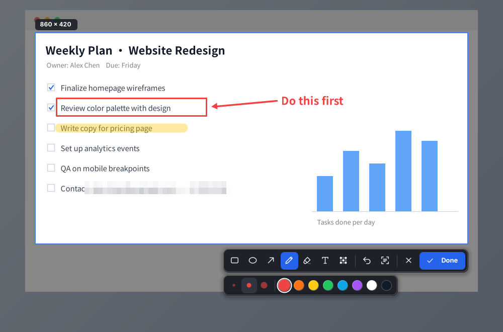
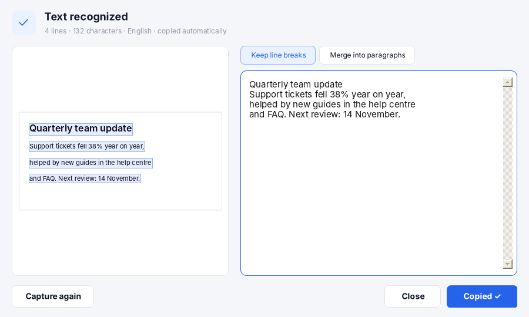

<p align="center">
  
</p>

<h1 align="center">LiteCap</h1>

<p align="center">
  Screenshots that are always JPG and always under 100&nbsp;KB, copied to the clipboard as a file.<br>
  Annotation and offline text recognition included. For Windows and macOS.
</p>

<p align="center">
  <a href="https://github.com/LorraineWong/LiteCap/releases/latest/download/LiteCap.exe">Download for Windows</a> ·
  <a href="https://github.com/LorraineWong/LiteCap/releases/latest/download/LiteCap.dmg">Download for macOS</a> ·
  <a href="CHANGELOG.md">Changelog</a> ·
  <a href="README.zh-CN.md">中文说明</a>
</p>

---

## Why

Many upload forms, ticketing systems and chat tools reject images over 100 KB. LiteCap removes the
"screenshot → open an editor → export → check size → try again" loop: every capture is saved as a
JPG that is already below the limit, at the highest quality that fits.

## Features

- **Region or full screen** — drag an area or click a window; full screen saves instantly
- **Always under the limit** — default 100 KB (adjustable); quality is tuned automatically, resolution is reduced only as a last resort
- **Copied as a file** — paste straight into email, chat or upload fields
- **Annotate** — rectangle, ellipse, arrow, pen, highlighter, text, mosaic; 8 colours, 3 sizes, undo
- **Offline text recognition (OCR)** — built into the OS; nothing leaves your computer
- **Delayed capture** — 3-second countdown for right-click menus and hover tips
- **English / Chinese interface** — English by default, switch in Settings

<p align="center">
  
</p>

<p align="center">
  
</p>

## Install

### Windows 10 / 11

1. Download **[LiteCap.exe](https://github.com/LorraineWong/LiteCap/releases/latest/download/LiteCap.exe)** and double-click it. The icon appears in the system tray.
2. If Windows shows "Windows protected your PC", click **More info → Run anyway** (the app is not code-signed).

One file, no installer, nothing else to install — it uses the .NET Framework 4.x that ships with Windows.
Tip: put it in a fixed folder (not Downloads) before turning on "Start with Windows".

### macOS 13 Ventura or later (Apple silicon and Intel)

1. Download **[LiteCap.dmg](https://github.com/LorraineWong/LiteCap/releases/latest/download/LiteCap.dmg)**, open it and drag **LiteCap** into **Applications**.
2. Open LiteCap. The first time, macOS blocks it because it is not notarized:
   **System Settings → Privacy & Security → Open Anyway**, then confirm.
3. In **System Settings → Privacy & Security → Screen Recording**, turn **LiteCap** on, then quit and reopen LiteCap.

> After updating to a new version, switch Screen Recording off and on again for LiteCap, then reopen it.
> If captures come out black, this is the fix.

### Updating

Download the new version from [Releases](https://github.com/LorraineWong/LiteCap/releases) and replace the old file
(Windows: quit LiteCap from the tray first). Settings are kept.

## Usage

| Action | Windows | macOS |
|---|---|---|
| Region capture (drag, or click a window) | `Ctrl+1` | `⌘1` |
| Full screen (screen under the pointer) | `Ctrl+2` | `⌘2` |
| Recognize text | tray menu / editor `O` / optional hotkey | `⌘3` / menu bar / editor `O` |
| Region in 3 seconds | tray menu | menu bar |

**Editor:** `R` rectangle · `E` ellipse · `A` arrow · `P` pen · `H` highlighter · `T` text · `M` mosaic · `1/2/3` size · `Ctrl/⌘+Z` undo · `O` recognize text
**Finish:** `Enter` / `Space` / `Ctrl/⌘+C` / double-click the selection · **Cancel:** `Esc`

Screenshots are saved to `Pictures/LiteCap`. Hotkeys, size limit, folder, language and start-up behaviour
are in **Settings** (right-click the tray icon on Windows, click the menu-bar icon on macOS).

### Text recognition

- **Windows** uses `Windows.Media.Ocr`. If it reports that no recognition language is installed:
  Settings → Time & language → Language & region → English or Chinese (Simplified) → ⋯ → Language options → install **Optical character recognition**.
- **macOS** uses Apple's Vision framework; nothing to install.

## Build from source

### Windows

Double-click `windows/build.bat`. It uses the C# compiler included with Windows
(`%WINDIR%\Microsoft.NET\Framework64\v4.0.30319\csc.exe`) and writes `windows/LiteCap.exe`.

### macOS

```bash
xcode-select --install     # once
cd macos
./build.sh                 # produces LiteCap.app (ad-hoc signed)
```

Or run `macos/Install.command`, which builds, installs into Applications and opens the app.

## Releasing

GitHub Actions (`.github/workflows/release.yml`) builds both apps on every push. To publish a version:

1. Set the version in `windows/src/Core.cs` (`AssemblyVersion`, `AssemblyFileVersion`) and `macos/Info.plist` (`CFBundleShortVersionString`).
2. Add a `## [x.y.z]` section to `CHANGELOG.md`.
3. Commit, then `git tag vx.y.z && git push origin vx.y.z`.

The workflow checks that the tag, both version numbers and the changelog agree, then publishes
`LiteCap.exe` and `LiteCap.dmg` as a release.

## Project layout

```
windows/        C# WinForms tray app (C# 5, .NET Framework 4.x)
  src/          Core, Overlay (editor), Ocr, OcrForm, SettingsForm, Tray, I18n, ...
  build.bat
macos/          Swift AppKit + SwiftUI menu-bar app
  Sources/
  Resources/    App and menu-bar icons
  build.sh, Install.command
docs/images/    Screenshots used in this README
```

## Privacy

LiteCap has no network code. Screenshots, recognized text and settings stay on your computer.
Logs are written only when an error occurs
(Windows: `%APPDATA%\LiteCap\logs`, macOS: `~/Library/Logs/LiteCap`).
